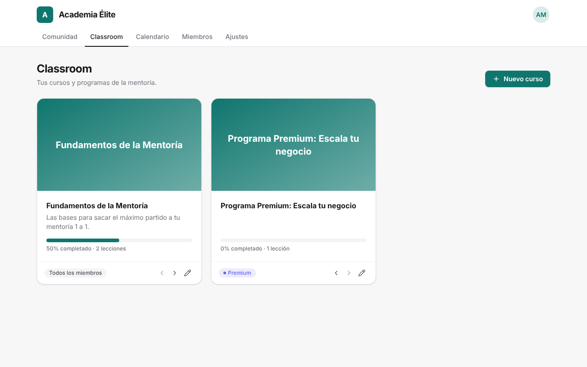
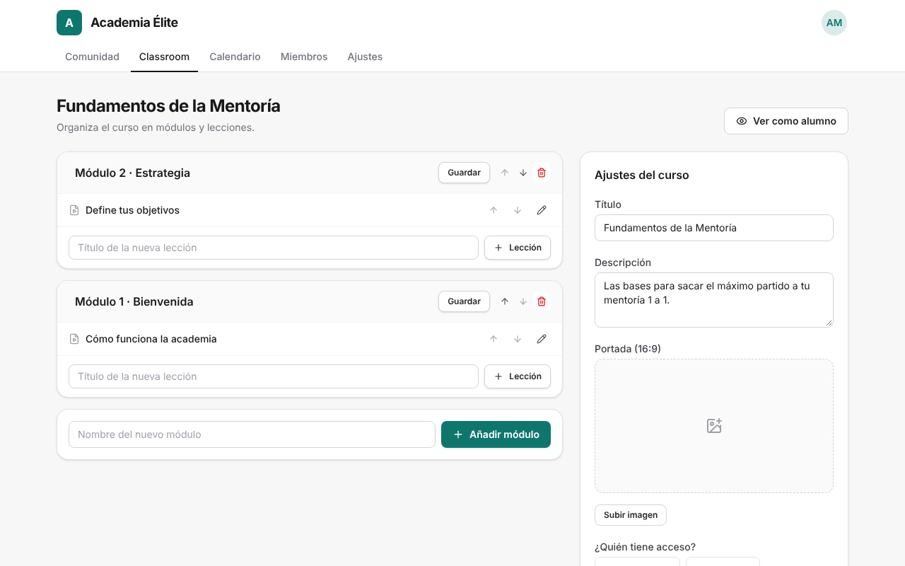
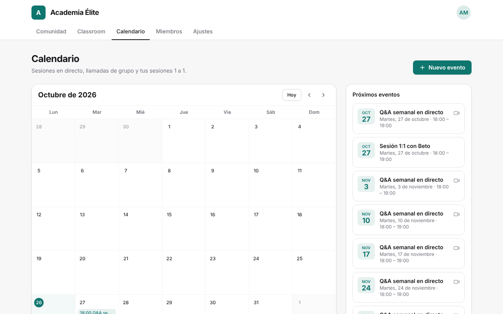
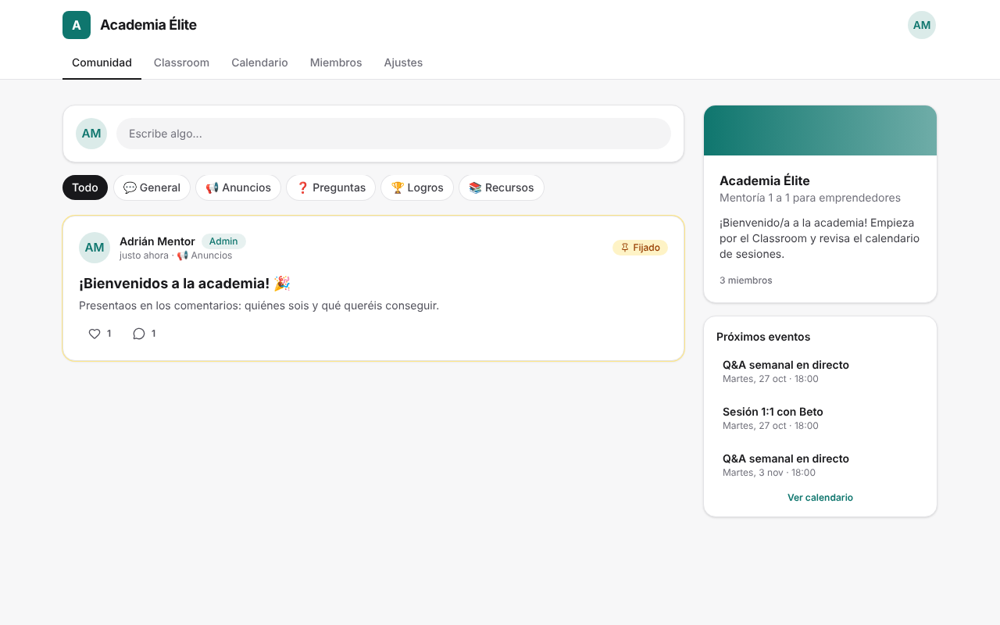
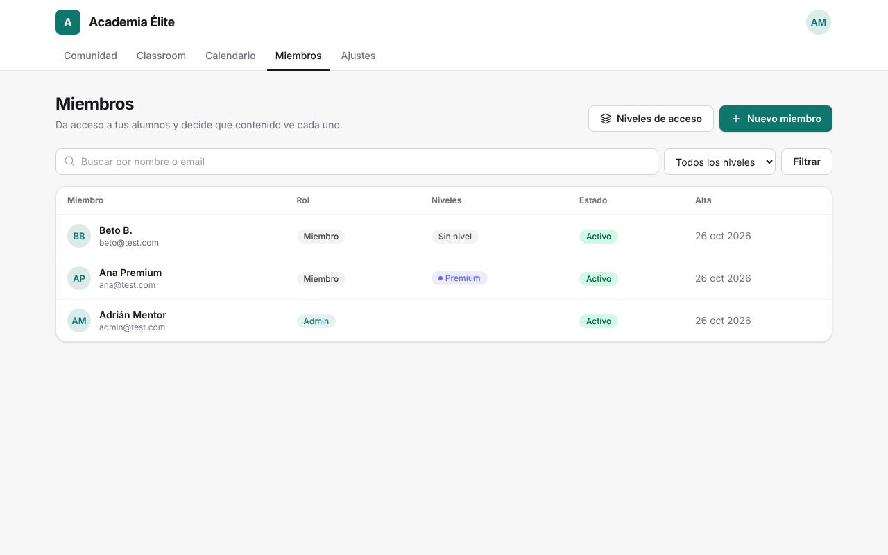

# 🎓 Academia de Mentoría

Plataforma privada tipo **Skool** para los miembros de tu mentoría 1 a 1: cada alumno inicia sesión con su cuenta y ve **solo el contenido que le corresponde**.



## ¿Qué incluye?

| Sección | Qué puedes hacer |
|---|---|
| **Classroom** | Cursos → módulos → lecciones. Cada lección tiene vídeo (YouTube, Vimeo, Loom, Google Drive o subido), texto con formato y archivos descargables (PDF, plantillas…). Los alumnos marcan lecciones como completadas y ven su % de progreso. |
| **Calendario** | Eventos en vista mensual, repetitivos (semanal, quincenal, mensual), con enlace de Zoom/Meet y botón «Añadir a Google Calendar». Puedes crear **sesiones 1:1 privadas** que solo ve ese miembro. Cada persona ve las horas en su zona horaria. |
| **Comunidad** | Publicaciones con categorías, comentarios, «me gusta» y anuncios fijados. |
| **Miembros** | Creas la cuenta de cada alumno en 10 segundos: se genera una contraseña y la envías por WhatsApp con un clic. Ves el progreso de cada alumno, le cambias el nivel, le quitas el acceso o le generas una contraseña nueva. |
| **Niveles de acceso** | Crea niveles como «Básico», «Premium» o «VIP 1:1» y decide qué cursos y eventos ve cada nivel. |
| **Ajustes** | Nombre de la academia, logo, color de marca y mensaje de bienvenida. |

### Roles

| Rol | Permisos |
|---|---|
| **Admin** (tú) | Todo: contenido, calendario, miembros, niveles y ajustes. |
| **Coach** | Crea y edita cursos, lecciones y eventos, y modera la comunidad. No gestiona miembros ni ajustes. |
| **Miembro** | Ve los cursos y eventos de sus niveles (más los que son para todos), participa en la comunidad y edita su perfil. |

> Un curso o evento **sin niveles** lo ven todos los miembros. Uno **con niveles** solo lo ven los miembros que tengan alguno de esos niveles. Los cursos bloqueados pueden mostrarse con un candado 🔒 para que sepan que existen (o esconderse del todo).

---

## 🚀 Puesta en marcha (unos 20 minutos, sin programar)

Necesitas una cuenta gratuita en [Supabase](https://supabase.com) (base de datos, usuarios y archivos) y otra en [Vercel](https://vercel.com) (donde se publica la web).

### 1. Crea el proyecto en Supabase

1. Entra en [supabase.com/dashboard](https://supabase.com/dashboard) → **New project**. Elige un nombre, una contraseña para la base de datos y la región más cercana a tus alumnos.
2. Cuando esté listo, ve a **SQL Editor → New query**.
3. Abre el archivo [`supabase/schema.sql`](supabase/schema.sql) de este repositorio, **copia todo su contenido**, pégalo y pulsa **Run**. Debe terminar con «Success. No rows returned».

### 2. Configura el acceso (Authentication)

1. **Authentication → Sign In / Providers**: desactiva **«Allow new users to sign up»**. Así nadie puede registrarse por su cuenta: solo entran las personas que tú das de alta.
2. **Authentication → URL Configuration** (hazlo cuando tengas la URL de Vercel del paso 4):
   - **Site URL**: `https://tu-academia.vercel.app` (o tu dominio).
   - **Redirect URLs**: añade `https://tu-academia.vercel.app/**`.

### 3. Copia tus claves

En **Project Settings → API Keys** (y **Data API** para la URL) copia:

| Variable | Dónde está |
|---|---|
| `NEXT_PUBLIC_SUPABASE_URL` | Project URL (`https://xxxx.supabase.co`) |
| `NEXT_PUBLIC_SUPABASE_PUBLISHABLE_KEY` | *Publishable key* (`sb_publishable_…`) — o la antigua *anon key* |
| `SUPABASE_SECRET_KEY` | *Secret key* (`sb_secret_…`) — o la antigua *service_role key*. **Nunca la compartas.** |
| `NEXT_PUBLIC_SITE_URL` | La URL pública de tu academia, ej. `https://tu-academia.vercel.app` |

### 4. Publica la web en Vercel

1. Sube este repositorio a tu GitHub (si aún no está).
2. En [vercel.com/new](https://vercel.com/new) importa el repositorio.
3. En **Environment Variables** pega las 4 variables del paso 3 y pulsa **Deploy**.
4. Cuando termine, copia la URL que te da Vercel, ponla en `NEXT_PUBLIC_SITE_URL` (Settings → Environment Variables) y en Supabase (paso 2.2), y vuelve a desplegar (Deployments → ⋯ → Redeploy).

### 5. Crea tu cuenta de administrador

Abre la URL de tu academia. La primera vez verás la pantalla **«¡Bienvenido/a!»**: escribe el nombre de la academia, tu nombre, email y contraseña. Esa cuenta será la de **Admin**. Esta pantalla desaparece para siempre en cuanto existe el primer usuario.

¡Listo! 🎉

---

## 📚 Uso diario

### Dar acceso a un alumno
1. **Miembros → Niveles de acceso**: crea tus niveles (ej. «Premium», «VIP 1:1»). Solo la primera vez.
2. **Miembros → Nuevo miembro**: nombre, email, rol y niveles → **Crear acceso**.
3. Pulsa **Enviar por WhatsApp** o **Copiar mensaje de bienvenida**: incluye el enlace, el email y la contraseña temporal.

¿Un alumno olvidó su contraseña? Entra en su ficha → **Nueva contraseña** y envíasela. ¿Terminó la mentoría? Desmarca **Cuenta activa** y pierde el acceso sin borrar su historial.

### Subir un módulo al Classroom
1. **Classroom → Nuevo curso** → título y descripción.
2. En el editor del curso: **Añadir módulo** (ej. «Módulo 1 · Bienvenida») y dentro **+ Lección**.
3. En cada lección: pega el enlace del vídeo **o** súbelo, escribe las notas y añade archivos descargables → **Guardar lección**.
4. En **Ajustes del curso** (columna derecha): sube una portada, elige **quién tiene acceso** y marca **Publicado**.

Puedes reordenar módulos y lecciones con las flechas ↑ ↓ y guardar lecciones como **borrador** mientras las preparas.



### Agendar sesiones
- **Calendario → Nuevo evento**. Para una llamada de grupo semanal elige «Cada semana».
- Para una **sesión 1:1**, entra en la ficha del miembro → **Agendar sesión 1:1** (el evento solo lo verá esa persona).



### Comunidad y marca
- Publica anuncios en la categoría **📢 Anuncios** y fíjalos arriba (📌 Fijar).
- En **Ajustes** cambia el nombre, el logo, el color principal y el mensaje de bienvenida.

| Comunidad | Miembros |
|---|---|
|  |  |

---

## 💡 Recomendaciones importantes

**Vídeos.** El plan gratuito de Supabase admite archivos de hasta 50 MB y 1 GB en total. Para vídeos de lecciones lo más cómodo es subirlos a **YouTube como «Oculto»**, **Vimeo** (en sus planes de pago puedes limitar la reproducción a tu dominio) o **Loom**, y pegar el enlace. La subida directa está pensada para vídeos cortos o si amplías tu plan de Supabase.

**Emails de «¿Olvidaste tu contraseña?».** El servidor de correo que trae Supabase de serie es solo para pruebas: envía muy pocos emails por hora y solo a las direcciones de tu equipo en Supabase. Para que los alumnos reciban esos emails, configura un SMTP propio en **Authentication → Emails → SMTP Settings** (por ejemplo [Resend](https://resend.com) o [Brevo](https://brevo.com), ambos con plan gratuito). Mientras tanto, puedes generar contraseñas nuevas desde el panel de **Miembros**, que no necesita email. Opcional: traduce la plantilla «Reset Password» en **Authentication → Emails → Templates**.

**Planes y costes.** Supabase Free y Vercel Hobby cuestan 0 €, pero ten en cuenta que Vercel Hobby es para uso personal/no comercial (para una academia de pago, Vercel pide el plan Pro) y que Supabase pausa los proyectos gratuitos tras una semana sin actividad. Revisa las condiciones actuales de cada servicio.

**Dominio propio.** En Vercel → Settings → Domains añade `academia.tudominio.com`, y actualiza `NEXT_PUBLIC_SITE_URL` y las URLs de Supabase (paso 2.2).

---

## 🔒 Seguridad

- Los permisos se aplican **en la base de datos** (Row Level Security de Postgres), no solo en la web: aunque alguien manipule la página, un miembro no puede leer cursos, lecciones, archivos o eventos que no le corresponden.
- Los vídeos y archivos subidos son **privados** y se sirven con enlaces temporales solo a quien tiene acceso.
- Los emails de los miembros solo los ve el administrador (los demás miembros no pueden obtenerlos).
- Un miembro no puede cambiarse el rol ni reactivarse a sí mismo.

---

## 🛠️ Para desarrolladores

Stack: **Next.js 16** (App Router, Server Actions) · **Supabase** (Auth, Postgres + RLS, Storage) · **Tailwind CSS 4** · TypeScript.

```bash
npm install
cp .env.example .env.local   # rellena las variables
npm run dev                  # http://localhost:3000
```

Con la [CLI de Supabase](https://supabase.com/docs/guides/local-development) puedes levantar todo en local (`supabase start`) y aplicar el esquema con `psql "$DB_URL" -f supabase/schema.sql`.

```
supabase/schema.sql          Tablas, funciones, políticas RLS y buckets de Storage
src/proxy.ts                 Refresca la sesión y protege las rutas privadas
src/lib/                     Clientes de Supabase, sesión/roles, tipos, vídeo, recurrencias
src/components/              Componentes de interfaz compartidos
src/app/(app)/comunidad      Feed, publicaciones y comentarios
src/app/(app)/classroom      Cursos, lecciones, editor y progreso
src/app/(app)/calendario     Calendario, eventos y sesiones 1:1
src/app/(app)/miembros       Alta de miembros, niveles de acceso y progreso
src/app/(app)/ajustes        Marca de la academia
src/app/login, setup, ...    Login, configuración inicial y recuperación de contraseña
```
